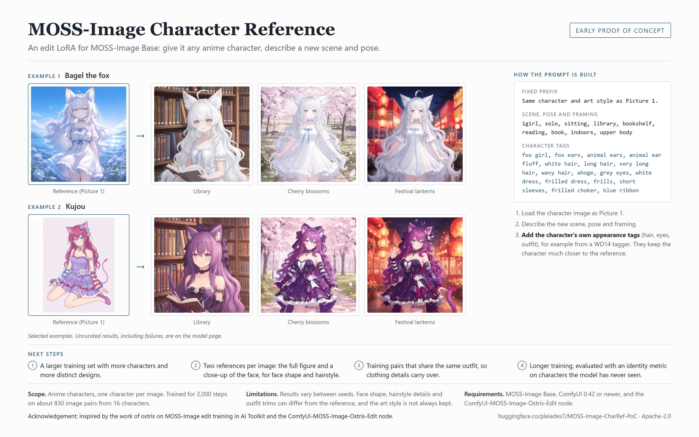
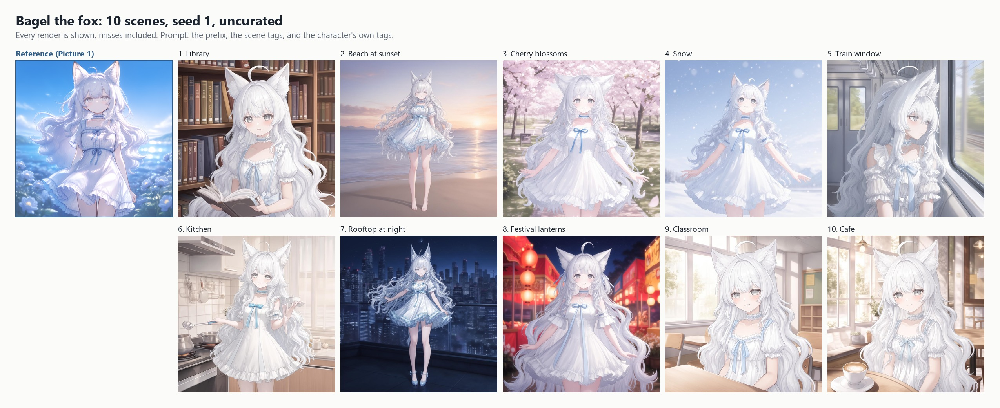
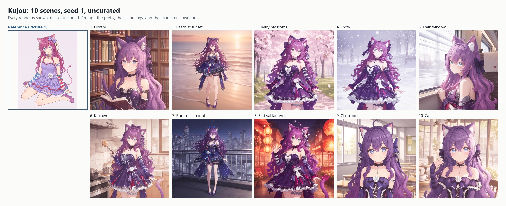
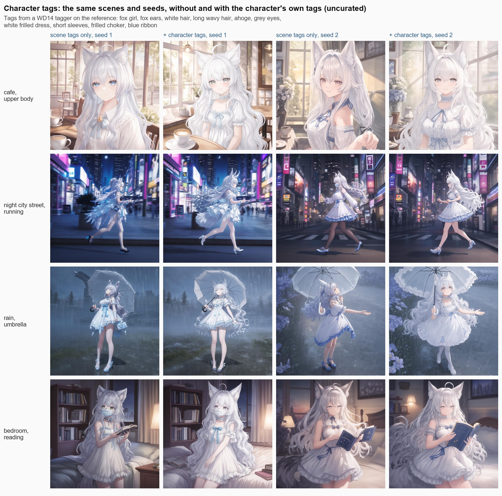
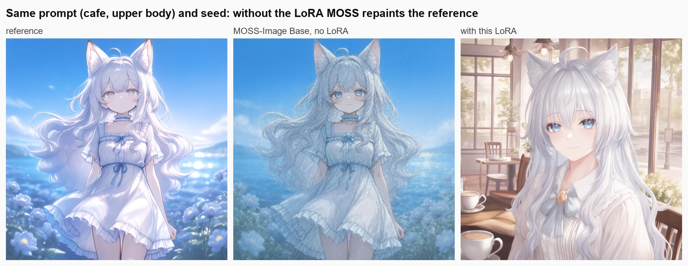

# MOSS-Image CharRef (early proof of concept)



An experimental edit LoRA for [MOSS-Image Base](https://huggingface.co/OpenMOSS-Team/MOSS-Image-Base): Picture 1 is an
anime character, the prompt describes a new scene and pose, and the model tries to draw the same character there.
It is not tied to any particular character: any anime character can be the reference. The characters shown below
are only examples.

Also on [Hugging Face](https://huggingface.co/pleiades7/MOSS-Image-CharRef-PoC) and [Civitai](https://civitai.com/models/3011337/moss-image-charref-early-experiment).

**Download the LoRA:** [`moss_image_charref_poc.safetensors`](https://github.com/TimothyZhang7/MOSS-Image-CharRef-PoC/releases/latest/download/moss_image_charref_poc.safetensors)
(145 MB, from the [latest release](https://github.com/TimothyZhang7/MOSS-Image-CharRef-PoC/releases/latest); also on
[Hugging Face](https://huggingface.co/pleiades7/MOSS-Image-CharRef-PoC/blob/main/moss_image_charref_poc.safetensors)).

> **Very preliminary.** This is a first experiment: a 2,000-step LoRA trained on about 830 image pairs from 16
> characters, tested on only a handful of characters. Expect rough results:
> - It usually picks up the broad look (hair colour, ears or horns, the main outfit colours), but often gets the
>   face shape, exact hairstyle and outfit details wrong.
> - The art style usually does not carry over.
> - Results vary a lot between seeds and characters.
> - Anime characters only.
>
> It is shared so others can try the idea. A properly trained version is planned.

## Examples (uncurated)

Ten scenes per character, one seed each, nothing removed. Prompts use the scene tags plus the character's own tags
(see "Character tags" below).





## Character tags

Always add the character's own appearance tags (hair, eyes, outfit) to the prompt. They keep the character much closer
to the reference: in the comparison below they fixed a swapped outfit, the eye colour and an invented face mask in
several cases, though not in all of them. An easy way to get the tags is to run a WD14 tagger on the reference and keep
the appearance tags (drop background and pose tags, and any wrong guesses).



## Why a LoRA is needed

MOSS-Image is a text-to-image model with no reference-image input. With the edit node but without this LoRA, it
repaints the reference and ignores the prompt. This LoRA is a first attempt at teaching it to keep the character and
follow the prompt instead.



## How to use (ComfyUI)

### 1. What you need

| | |
|---|---|
| ComfyUI | **v0.42.0 or newer**, which has MOSS-Image support |
| Custom node | [ComfyUI-MOSS-Image-Ostris-Edit](https://github.com/ostris/ComfyUI-MOSS-Image-Ostris-Edit) by ostris: clone it into `custom_nodes` and restart |
| Model | [`moss_image_base_int8_convrot.safetensors`](https://huggingface.co/Comfy-Org/MOSS-Image/resolve/main/diffusion_models/moss_image_base_int8_convrot.safetensors) (or the bf16 file) → `models/diffusion_models` |
| Text encoder | [`qwen3.5_9b_int8_convrot.safetensors`](https://huggingface.co/Comfy-Org/MOSS-Image/resolve/main/text_encoders/qwen3.5_9b_int8_convrot.safetensors) → `models/text_encoders` (it must include the vision weights; the Comfy-Org files do) |
| VAE | [`flux2-vae.safetensors`](https://huggingface.co/Comfy-Org/MOSS-Image/resolve/main/vae/flux2-vae.safetensors) → `models/vae` |
| This LoRA | [`moss_image_charref_poc.safetensors`](https://github.com/TimothyZhang7/MOSS-Image-CharRef-PoC/releases/latest/download/moss_image_charref_poc.safetensors) → `models/loras` |

Use the **Base** model, not SFT: the LoRA was trained on Base.

### 2. Load the workflow

Drag [`workflows/moss_image_charref_poc.json`](workflows/moss_image_charref_poc.json) into ComfyUI, or drag the example image
[`workflows/moss_image_charref_poc_workflow.png`](workflows/moss_image_charref_poc_workflow.png), which has the same
workflow embedded. The note inside the workflow repeats the steps below.

### 3. Pick a reference

- One character, **large and clearly visible**: full body or upper body, ideally on a simple background.
- A tiny character in a wide scene does not work; the text encoder only sees the reference at about 384×384.
- The workflow scales the reference to about 1 megapixel for you.

### 4. Write the prompt

A prompt has three parts: the fixed prefix, comma-separated tags for the **scene, pose, framing and expression**, and
the character's own **appearance tags**:

```
Same character and art style as Picture 1. 1girl, solo, sitting, cafe, table, cup, window, sunlight, light smile, upper body, fox girl, fox ears, white hair, long hair, wavy hair, ahoge, grey eyes, white dress, frilled dress, short sleeves, frilled choker, blue ribbon
```

- The scene tags say what changes; the character tags keep the character (see "Character tags" above). The reference
  still supplies everything the tags do not describe.
- Danbooru-style tags work best; the LoRA was trained on them.
- Leave the negative prompt empty (it still gets the reference image).

### 5. Settings

| Setting | Value |
|---|---|
| Steps / CFG | 30 / 3.0 |
| Sampler / scheduler | euler / simple |
| Edit patch (`MOSSImageOstrisEditModelPatch`) | `kv_cache` **on** |
| Skip layer guidance | single layer `22`, 0.0–1.0 |
| Output size | about 1 MP, any aspect ratio (1024×1024, 832×1216, 1216×832) |
| LoRA strength | 1.0 (try 0.8–1.2) |

**Tips**

- Framing that shows the face larger (`upper body`, `cowboy shot`) keeps the face closer to the reference.
- Try a few seeds; identity holds better on some than others.

## Limitations

- Anime characters only. Not trained on, and not meant for, real people.
- One character, one reference image. Trained with a single reference; extra reference slots are untested.
- Fine identity details are often wrong: face shape, small hair features, outfit trims and patterns.
- The reference's art style usually comes out more like MOSS's default anime look.
- Early experiment: small dataset, short training, very little testing. Not tuned or evaluated beyond a few examples.

## Training

- Trainer: [AI Toolkit](https://github.com/ostris/ai-toolkit), MOSS-Image Base in edit mode (`edit`, `kv_cache`,
  `match_target_res`, block 22 skipped on the negative branch). The base was quantized to int8 (convrot8) while training.
- LoRA rank 32, alpha 32, AdamW 8-bit, learning rate 1e-4, batch 1, 2,000 steps, 1024 px.
- Data: about 830 pairs from 16 anime characters. Each pair has a target image and another image of the same character as
  the reference. Captions describe only the pose, scene, framing and expression, behind the fixed prefix above
  (appearance tags were not in the training captions; adding them at inference works anyway).

## What's next

A properly trained version is planned, aimed at the details this one misses:

1. A larger training set with more characters and more distinct designs.
2. Two references per image: the full figure and a close-up of the face, for face shape and hairstyle.
3. Training pairs that share the same outfit, so clothing details carry over.
4. Longer training, evaluated with an identity metric on characters the model has never seen.

## Credits

- Inspired by the work of [ostris](https://github.com/ostris) on MOSS-Image edit training.

- [OpenMOSS](https://huggingface.co/OpenMOSS-Team) for MOSS-Image (Apache-2.0).
- [ostris](https://github.com/ostris) for MOSS-Image edit training in AI Toolkit and the ComfyUI edit node.
- [Comfy-Org](https://huggingface.co/Comfy-Org/MOSS-Image) for the ComfyUI model files.

License: Apache-2.0, the same as the base model.
